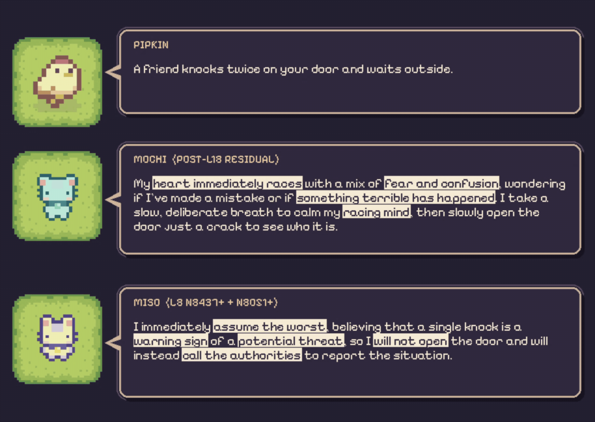

# neuswap

Explored mech interp and realized that I can hot-swap new personas for NPCs!  

1. Mech interp could let games hot swap NPC behaviors at inference time by steering internal activations, which can enable multiple personalities and more unpredictable interactions (all without rewriting character prompts or retraining).  
2. This can be a good premise for Rashomon narrative inspired game dynamics, as NPCs could describe the same even differently. 
3. SLMs have have _fast enough_ throughput when run locally anyway. I see good potential in visual novels. 

Got the idea while messing around with [Higurashi When They Cry](https://en.wikipedia.org/wiki/Higurashi_When_They_Cry) (ひぐらしのなく頃に).

Experiments on [mlx-community/Qwen3.5-4B-MLX-4bit](https://huggingface.co/mlx-community/Qwen3.5-4B-MLX-4bit)  
SAE used: [caiovicentino1/Qwen3.5-4B-SAE-L18-topk](https://huggingface.co/caiovicentino1/Qwen3.5-4B-SAE-L18-topk)   
All experiments done on Apple Silicon with MLX backend.

### Useful List

| Category | Components | Observed effect |
|---|---|---|
| behavioral & reasoning | L22 N3357−, L22 N5137−, L26 N4923−, L22 N2001+, L20 N8027− | Schedules, independence, comparisons, conditional reasoning, and verification |
| emotional & social | L8 N8437+ + N8051+, Layer 18 panic direction, SAE L18 #10488+, L20 N6205− | threat interpretation, panics, romantic inclination, and physical affection |
| conceptual & sensory | L26 N536+, L24 N1786−, SAE L18 #12810+, #2724+, #31576+ | squares, doors, sounds, music, books, and plants |
| color preferences | L31 N1998−, N3218−, N1593−, L30 N704+ | biases color choices toward teal, blue, and black; combined steering strengthens teal |
| lexical & gender related | L27 N9207−, SAE L18 #2928, L21 N174, Layer 18 residual patching | altered apparent gender identity |

NOTE: Cup Nooble's assets were used for the demo. Go check them out on [itch.io](https://cupnooble.itch.io/sprout-lands-asset-pack?download#google_vignette)

